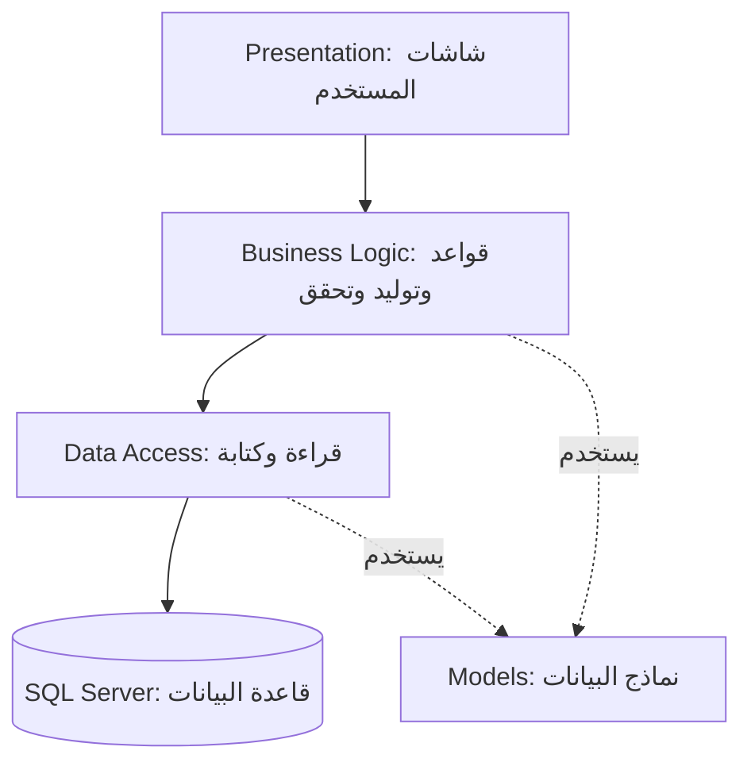

# خارطة طبقات نظام الجدول الجامعي

النطاق: تطبيق سطح المكتب فقط. تاريخ مراجعة المصدر: 2026-10-26.

[افتح الخريطة المرئية القابلة للبحث والطباعة](PROJECT_MAP_AR.html)

الأسهم مخطط تبسيطي للاستخدام. Models مكتبة مشتركة وليست مرحلة تأتي بعد قاعدة البيانات.

## Presentation — واجهة المستخدم

الشاشات التي يتعامل معها المستخدم، وعرض البيانات وتنفيذ أوامر التحرير.

حدود المسؤولية: تستدعي خدمات BLL؛ لا تتصل بقاعدة البيانات مباشرة في ملفات C# التي فُحصت.

| المكوّن | وظيفته | الملفات |
|---|---|---|
| `ArabicUi` | تطبيق إعدادات العرض العربي واتجاه الواجهة. | [ArabicUi.cs](../University%20Timetable%20and%20Classroom%20Management%20System/PresentationLayer/ArabicUi.cs) |
| `ArabicUiText` | نصوص ومصطلحات عربية مشتركة للواجهة. | [ArabicUiText.cs](../University%20Timetable%20and%20Classroom%20Management%20System/PresentationLayer/ArabicUiText.cs) |
| `BranchesForm` | عرض التخصصات وإضافتها وتعديلها وحذفها. | [BranchesForm.cs](../University%20Timetable%20and%20Classroom%20Management%20System/PresentationLayer/BranchesForm.cs) [BranchesForm.Designer.cs](../University%20Timetable%20and%20Classroom%20Management%20System/PresentationLayer/BranchesForm.Designer.cs) |
| `ClassroomsForm` | إدارة القاعات والمختبرات وخصائصها. | [ClassroomsForm.cs](../University%20Timetable%20and%20Classroom%20Management%20System/PresentationLayer/ClassroomsForm.cs) [ClassroomsForm.Designer.cs](../University%20Timetable%20and%20Classroom%20Management%20System/PresentationLayer/ClassroomsForm.Designer.cs) |
| `ComboBoxHelper` | مساعدة مشتركة لربط القوائم واختيار قيمها. | [ComboBoxHelper.cs](../University%20Timetable%20and%20Classroom%20Management%20System/PresentationLayer/Common/ComboBoxHelper.cs) |
| `ComboOption` | نموذج خيار للقوائم المنسدلة. | [ComboOption.cs](../University%20Timetable%20and%20Classroom%20Management%20System/PresentationLayer/Common/ComboOption.cs) |
| `EditorAction` | توحيد دورة التحرير غير المتزامن وحالة عناصر التحكم ورسائل النتيجة. | [EditorAction.cs](../University%20Timetable%20and%20Classroom%20Management%20System/PresentationLayer/Common/EditorAction.cs) |
| `DesignerEnvironment` | تمييز بيئة التصميم عن التشغيل لمنع تهيئة غير مناسبة داخل المصمم. | [DesignerEnvironment.cs](../University%20Timetable%20and%20Classroom%20Management%20System/PresentationLayer/DesignerEnvironment.cs) |
| `DesignerHtmlLabel` | عنصر نص متوافق مع المصمم ودورة حياة التحكم. | [DesignerHtmlLabel.cs](../University%20Timetable%20and%20Classroom%20Management%20System/PresentationLayer/DesignerHtmlLabel.cs) |
| `ExcelImportForm` | واجهة استيراد Excel وPDF وربط الأعمدة ومعاينة البيانات ونتائج التحقق. | [ExcelImportForm.cs](../University%20Timetable%20and%20Classroom%20Management%20System/PresentationLayer/ExcelImportForm.cs) [ExcelImportForm.Designer.cs](../University%20Timetable%20and%20Classroom%20Management%20System/PresentationLayer/ExcelImportForm.Designer.cs) |
| `FacultyMembersForm` | إدارة بيانات التدريسيين. | [FacultyMembersForm.cs](../University%20Timetable%20and%20Classroom%20Management%20System/PresentationLayer/FacultyMembersForm.cs) [FacultyMembersForm.Designer.cs](../University%20Timetable%20and%20Classroom%20Management%20System/PresentationLayer/FacultyMembersForm.Designer.cs) |
| `FacultyMemberSubjectsForm` | إسناد المواد والشعب وأنواع المحاضرات إلى التدريسيين؛ ملف Scope يضبط نطاق التكليف. | [FacultyMemberSubjectsForm.cs](../University%20Timetable%20and%20Classroom%20Management%20System/PresentationLayer/FacultyMemberSubjectsForm.cs) [FacultyMemberSubjectsForm.Designer.cs](../University%20Timetable%20and%20Classroom%20Management%20System/PresentationLayer/FacultyMemberSubjectsForm.Designer.cs) [FacultyMemberSubjectsForm.Scope.cs](../University%20Timetable%20and%20Classroom%20Management%20System/PresentationLayer/FacultyMemberSubjectsForm.Scope.cs) |
| `FacultyPreferencesForm` | تحرير تفضيلات أيام التدريسي وعرض أثر حفظها. | [FacultyPreferencesForm.cs](../University%20Timetable%20and%20Classroom%20Management%20System/PresentationLayer/FacultyPreferencesForm.cs) [FacultyPreferencesForm.Designer.cs](../University%20Timetable%20and%20Classroom%20Management%20System/PresentationLayer/FacultyPreferencesForm.Designer.cs) |
| `FacultyScheduleEditorForm` | عرض خطة التدريسي ومعاينة التعديلات والتحسين قبل الحفظ. | [FacultyScheduleEditorForm.cs](../University%20Timetable%20and%20Classroom%20Management%20System/PresentationLayer/FacultyScheduleEditorForm.cs) [FacultyScheduleEditorForm.Designer.cs](../University%20Timetable%20and%20Classroom%20Management%20System/PresentationLayer/FacultyScheduleEditorForm.Designer.cs) |
| `FormNavigation` | تعريف صفحات التنقل وإنشاؤها وضبط القائمة الجانبية. | [FormNavigation.cs](../University%20Timetable%20and%20Classroom%20Management%20System/PresentationLayer/FormNavigation.cs) |
| `GridRowNumbers` | إظهار أرقام الصفوف دون تغيير معرفات السجلات الحقيقية. | [GridRowNumbers.cs](../University%20Timetable%20and%20Classroom%20Management%20System/PresentationLayer/GridRowNumbers.cs) |
| `ImportUiText` | تحويل رسائل الاستيراد إلى نص عربي مفهوم. | [ImportUiText.cs](../University%20Timetable%20and%20Classroom%20Management%20System/PresentationLayer/ImportUiText.cs) |
| `LayoutUpdateScope` | تجميع تحديثات التخطيط وتقليل تكرار Layout أثناء التهيئة. | [LayoutUpdateScope.cs](../University%20Timetable%20and%20Classroom%20Management%20System/PresentationLayer/LayoutUpdateScope.cs) |
| `LoginForm` | إدخال بيانات الدخول واستدعاء خدمة التحقق من الحساب. | [LoginForm.cs](../University%20Timetable%20and%20Classroom%20Management%20System/PresentationLayer/LoginForm.cs) [LoginForm.Designer.cs](../University%20Timetable%20and%20Classroom%20Management%20System/PresentationLayer/LoginForm.Designer.cs) |
| `MainShellForm` | النافذة الرئيسية وحاوية التنقل بين صفحات الإدارة. | [MainShellForm.cs](../University%20Timetable%20and%20Classroom%20Management%20System/PresentationLayer/MainShellForm.cs) [MainShellForm.Designer.cs](../University%20Timetable%20and%20Classroom%20Management%20System/PresentationLayer/MainShellForm.Designer.cs) |
| `PasswordToggleIcon` | عنصر تبديل إظهار كلمة المرور وإخفائها. | [PasswordToggleIcon.cs](../University%20Timetable%20and%20Classroom%20Management%20System/PresentationLayer/PasswordToggleIcon.cs) |
| `RegisterForm` | إدخال حساب جديد وعرض نتيجة التسجيل. | [RegisterForm.cs](../University%20Timetable%20and%20Classroom%20Management%20System/PresentationLayer/RegisterForm.cs) [RegisterForm.Designer.cs](../University%20Timetable%20and%20Classroom%20Management%20System/PresentationLayer/RegisterForm.Designer.cs) |
| `ResponsiveCardPanel` | حاوية تدعم تخطيط عناصر الواجهة المتجاوب. | [ResponsiveCardPanel.cs](../University%20Timetable%20and%20Classroom%20Management%20System/PresentationLayer/ResponsiveCardPanel.cs) |
| `ResponsiveFlowPanel` | توزيع عناصر الواجهة بشكل متدفق حسب المساحة. | [ResponsiveFlowPanel.cs](../University%20Timetable%20and%20Classroom%20Management%20System/PresentationLayer/ResponsiveFlowPanel.cs) |
| `ResponsiveWorkspacePanel` | تنظيم مساحة العمل عند تغير حجم النافذة. | [ResponsiveWorkspacePanel.cs](../University%20Timetable%20and%20Classroom%20Management%20System/PresentationLayer/ResponsiveWorkspacePanel.cs) |
| `ScheduleFilterCriteria` | حفظ قيم فلاتر الجدول. | [ScheduleFilterCriteria.cs](../University%20Timetable%20and%20Classroom%20Management%20System/PresentationLayer/ScheduleFiltering/ScheduleFilterCriteria.cs) |
| `ScheduleFilterService` | تطبيق معايير التصفية على صفوف الجدول المعروضة. | [ScheduleFilterService.cs](../University%20Timetable%20and%20Classroom%20Management%20System/PresentationLayer/ScheduleFiltering/ScheduleFilterService.cs) |
| `SchedulesForm` | الشاشة المركزية للجدول: تحميله وتحريره وتوليده وتصفية عرضه وتثبيت محاضراته ونسخه وتصديره؛ موزعة على ملفات partial. | [SchedulesForm.Actions.cs](../University%20Timetable%20and%20Classroom%20Management%20System/PresentationLayer/SchedulesForm.Actions.cs) [SchedulesForm.Backup.cs](../University%20Timetable%20and%20Classroom%20Management%20System/PresentationLayer/SchedulesForm.Backup.cs) [SchedulesForm.cs](../University%20Timetable%20and%20Classroom%20Management%20System/PresentationLayer/SchedulesForm.cs) [SchedulesForm.Designer.cs](../University%20Timetable%20and%20Classroom%20Management%20System/PresentationLayer/SchedulesForm.Designer.cs) [SchedulesForm.Grid.cs](../University%20Timetable%20and%20Classroom%20Management%20System/PresentationLayer/SchedulesForm.Grid.cs) [SchedulesForm.Loading.cs](../University%20Timetable%20and%20Classroom%20Management%20System/PresentationLayer/SchedulesForm.Loading.cs) [SchedulesForm.Locks.cs](../University%20Timetable%20and%20Classroom%20Management%20System/PresentationLayer/SchedulesForm.Locks.cs) [SchedulesForm.Resizing.cs](../University%20Timetable%20and%20Classroom%20Management%20System/PresentationLayer/SchedulesForm.Resizing.cs) [SchedulesForm.Timetable.cs](../University%20Timetable%20and%20Classroom%20Management%20System/PresentationLayer/SchedulesForm.Timetable.cs) [SchedulesForm.Validation.cs](../University%20Timetable%20and%20Classroom%20Management%20System/PresentationLayer/SchedulesForm.Validation.cs) |
| `ScheduleTimetableGrid` | رسم الجدول بصريًا حسب الأيام والفترات. | [ScheduleTimetableGrid.cs](../University%20Timetable%20and%20Classroom%20Management%20System/PresentationLayer/ScheduleTimetableGrid.cs) |
| `SectionsForm` | إدارة الشعب وربطها بالمرحلة والتخصص. | [SectionsForm.cs](../University%20Timetable%20and%20Classroom%20Management%20System/PresentationLayer/SectionsForm.cs) [SectionsForm.Designer.cs](../University%20Timetable%20and%20Classroom%20Management%20System/PresentationLayer/SectionsForm.Designer.cs) |
| `StudyYearsForm` | إدارة المراحل الدراسية. | [StudyYearsForm.cs](../University%20Timetable%20and%20Classroom%20Management%20System/PresentationLayer/StudyYearsForm.cs) [StudyYearsForm.Designer.cs](../University%20Timetable%20and%20Classroom%20Management%20System/PresentationLayer/StudyYearsForm.Designer.cs) |
| `SubjectsForm` | إدارة المواد وبياناتها وأعداد محاضراتها الأسبوعية. | [SubjectsForm.cs](../University%20Timetable%20and%20Classroom%20Management%20System/PresentationLayer/SubjectsForm.cs) [SubjectsForm.Designer.cs](../University%20Timetable%20and%20Classroom%20Management%20System/PresentationLayer/SubjectsForm.Designer.cs) |
| `TimeDisplay` | تنسيق عرض الوقت. | [TimeDisplay.cs](../University%20Timetable%20and%20Classroom%20Management%20System/PresentationLayer/TimeDisplay.cs) |
| `TimeSlotsForm` | إدارة فترات المحاضرات وأوقات بدايتها ونهايتها. | [TimeSlotsForm.cs](../University%20Timetable%20and%20Classroom%20Management%20System/PresentationLayer/TimeSlotsForm.cs) [TimeSlotsForm.Designer.cs](../University%20Timetable%20and%20Classroom%20Management%20System/PresentationLayer/TimeSlotsForm.Designer.cs) |
| `TimetableAlternativesForm` | معاينة بدائل الجدول ومقارنتها وتحديد المحاضرات المثبتة. | [TimetableAlternativesForm.cs](../University%20Timetable%20and%20Classroom%20Management%20System/PresentationLayer/TimetableAlternativesForm.cs) [TimetableAlternativesForm.Designer.cs](../University%20Timetable%20and%20Classroom%20Management%20System/PresentationLayer/TimetableAlternativesForm.Designer.cs) |
| `UiMessages` | توحيد رسائل الخطأ والمعلومات والتأكيد. | [UiMessages.cs](../University%20Timetable%20and%20Classroom%20Management%20System/PresentationLayer/UiMessages.cs) |
| `ScheduleRow` | تحويل تفاصيل الجدول إلى صف مناسب للعرض. | [ScheduleRow.cs](../University%20Timetable%20and%20Classroom%20Management%20System/PresentationLayer/ViewModels/ScheduleRow.cs) |
| `WindowSizing` | حساب أحجام النوافذ وملاءمتها لمساحة الشاشة. | [WindowSizing.cs](../University%20Timetable%20and%20Classroom%20Management%20System/PresentationLayer/WindowSizing.cs) |
| `Program` | نقطة بدء تطبيق Windows وتهيئة تشغيل الواجهة. | [Program.cs](../University%20Timetable%20and%20Classroom%20Management%20System/Program.cs) |

## Business Logic — منطق العمل

قواعد الجامعة، إنشاء الجدول، فحص التعارضات، الاستيراد، التفضيلات والتصدير.

حدود المسؤولية: تستخدم DAL وModels؛ الخدمات تنشئ AppDbContext مباشرة في مسارات متعددة.

| المكوّن | وظيفته | الملفات |
|---|---|---|
| `TimetableBackupModels` | نماذج النسخة المحفوظة ومعاينة الاستعادة ونتائجها. | [TimetableBackupModels.cs](../Business_Logic_Layer/Backups/TimetableBackupModels.cs) |
| `TimetableBackupService` | حفظ نسخ الجدول ومعاينة استعادتها والتحقق منها ثم استعادتها. | [TimetableBackupService.cs](../Business_Logic_Layer/Backups/TimetableBackupService.cs) |
| `FacultyCpSatPlanner` | صياغة وحل تخطيط التدريسي باستعمال CP-SAT. | [FacultyCpSatPlanner.cs](../Business_Logic_Layer/FacultyScheduling/FacultyCpSatPlanner.cs) |
| `FacultyDayPreferenceService` | ملف partial لخدمة محرر التدريسي: حفظ تفضيلات الأيام وإعادة التحسين. | [FacultyDayPreferenceService.cs](../Business_Logic_Layer/FacultyScheduling/FacultyDayPreferenceService.cs) |
| `FacultyPracticalExchange` | تخطيط وتحقق تبادل مجموعات العملي. | [FacultyPracticalExchange.cs](../Business_Logic_Layer/FacultyScheduling/FacultyPracticalExchange.cs) |
| `FacultyPreferenceMeasurement` | قياس ومقارنة أثر الخطة على تفضيلات التدريسيين. | [FacultyPreferenceMeasurement.cs](../Business_Logic_Layer/FacultyScheduling/FacultyPreferenceMeasurement.cs) |
| `FacultyPreferenceRules` | قواعد صلاحية التفضيلات وتطبيقها على الجدولة. | [FacultyPreferenceRules.cs](../Business_Logic_Layer/FacultyScheduling/FacultyPreferenceRules.cs) |
| `FacultyPreferenceService` | قراءة ملفات تفضيلات التدريسيين وحفظها. | [FacultyPreferenceService.cs](../Business_Logic_Layer/FacultyScheduling/FacultyPreferenceService.cs) |
| `FacultyScheduleEditorService` | معاينة خطة التدريسي والتحقق منها وحفظ التغييرات. | [FacultyScheduleEditorService.cs](../Business_Logic_Layer/FacultyScheduling/FacultyScheduleEditorService.cs) |
| `FacultyScheduleModels` | نماذج طلب ومعاينة وخطة التدريسي ونتائج التحقق. | [FacultyScheduleModels.cs](../Business_Logic_Layer/FacultyScheduling/FacultyScheduleModels.cs) |
| `FacultySchedulingRuntime` | تهيئة مكتبات حل الجدولة الأصلية اللازمة للتشغيل. | [FacultySchedulingRuntime.cs](../Business_Logic_Layer/FacultyScheduling/FacultySchedulingRuntime.cs) |
| `ScheduleQualityAnalyzer` | تحليل جودة الجدول من حيث توزيع الأيام والفجوات ومؤشرات الخطة. | [ScheduleQualityAnalyzer.cs](../Business_Logic_Layer/FacultyScheduling/ScheduleQualityAnalyzer.cs) |
| `SchedulingCpSupport` | بناء قيود CP-SAT للموارد والأيام والتفضيلات وأولويات الجودة. | [SchedulingCpSupport.cs](../Business_Logic_Layer/FacultyScheduling/SchedulingCpSupport.cs) |
| `AutoKeyGenerator` | حساب المفتاح التالي أو أول مفتاح متاح للسجلات. | [AutoKeyGenerator.cs](../Business_Logic_Layer/Helpers/AutoKeyGenerator.cs) |
| `ManualKeySaveHelper` | مساعدة حفظ السجلات التي تستخدم توليد مفاتيح يدويًا. | [ManualKeySaveHelper.cs](../Business_Logic_Layer/Helpers/ManualKeySaveHelper.cs) |
| `AcademicExcelImport` | ملف partial لخدمة الاستيراد: استيراد البيانات الأكاديمية وحفظها. | [AcademicExcelImport.cs](../Business_Logic_Layer/Importing/AcademicExcelImport.cs) |
| `ExcelImportModels` | نماذج المصنف والصفوف والمعاينة والأخطاء وخطط الاستيراد. | [ExcelImportModels.cs](../Business_Logic_Layer/Importing/ExcelImportModels.cs) |
| `ExcelImportSchema` | تعريف مخططات الأوراق والأعمدة وأنماط الاستيراد. | [ExcelImportSchema.cs](../Business_Logic_Layer/Importing/ExcelImportSchema.cs) |
| `ExcelImportService` | تنسيق قراءة الاستيراد والتحقق والمعاينة والحفظ. | [ExcelImportService.cs](../Business_Logic_Layer/Importing/ExcelImportService.cs) |
| `ExcelImportTemplates` | إنشاء قوالب ملفات الاستيراد. | [ExcelImportTemplates.cs](../Business_Logic_Layer/Importing/ExcelImportTemplates.cs) |
| `ExcelWorkbookReader` | قراءة المصنفات والأوراق والخلايا من Excel. | [ExcelWorkbookReader.cs](../Business_Logic_Layer/Importing/ExcelWorkbookReader.cs) |
| `ImportCatalog` | تحميل وتجميع البيانات المرجعية اللازمة لمطابقة الاستيراد والجدولة. | [ImportCatalog.cs](../Business_Logic_Layer/Importing/ImportCatalog.cs) |
| `ImportedTimetableRepair` | ملف partial لخدمة الاستيراد: معاينة إصلاح الجدول المستورد والتحقق منه وحفظه. | [ImportedTimetableRepair.cs](../Business_Logic_Layer/Importing/ImportedTimetableRepair.cs) |
| `ImportedTimetableRepairPlanner` | حل خطة إصلاح الجدول المستورد مع مراعاة القيود. | [ImportedTimetableRepairPlanner.cs](../Business_Logic_Layer/Importing/ImportedTimetableRepairPlanner.cs) |
| `ImportFileReader` | اختيار قارئ الملف المناسب للاستيراد. | [ImportFileReader.cs](../Business_Logic_Layer/Importing/ImportFileReader.cs) |
| `ImportLabels` | أسماء ومرادفات عناوين بيانات الاستيراد. | [ImportLabels.cs](../Business_Logic_Layer/Importing/ImportLabels.cs) |
| `ImportValues` | تنظيف قيم الاستيراد وتطبيعها وتحويل أنواعها. | [ImportValues.cs](../Business_Logic_Layer/Importing/ImportValues.cs) |
| `NamedAssignmentImport` | ملف partial لخدمة الاستيراد: مطابقة التكليفات المسماة بالتدريسي والمادة. | [NamedAssignmentImport.cs](../Business_Logic_Layer/Importing/NamedAssignmentImport.cs) |
| `PdfTableReader` | استخراج النصوص والصفوف والخلايا من جداول PDF. | [PdfTableReader.cs](../Business_Logic_Layer/Importing/PdfTableReader.cs) |
| `WeeklyPdfTimetableReader` | فهم صيغة الجدول الأسبوعي في PDF وتحويلها إلى صفوف استيراد. | [WeeklyPdfTimetableReader.cs](../Business_Logic_Layer/Importing/WeeklyPdfTimetableReader.cs) |
| `DatabaseMaintenanceService` | تنسيق تطبيق إصلاحات وصيانة قاعدة البيانات. | [DatabaseMaintenanceService.cs](../Business_Logic_Layer/Maintenance/DatabaseMaintenanceService.cs) |
| `FourthYearPracticalMaintenance` | مواءمة بيانات عملي المرحلة الرابعة مع قواعد الشعب. | [FourthYearPracticalMaintenance.cs](../Business_Logic_Layer/Maintenance/FourthYearPracticalMaintenance.cs) |
| `SchedulingResourceMaintenance` | صيانة بيانات موارد الجدولة والتوافق مع القواعد القائمة. | [SchedulingResourceMaintenance.cs](../Business_Logic_Layer/Maintenance/SchedulingResourceMaintenance.cs) |
| `AcademicStructureRules` | قواعد المراحل والتخصصات والشعب والمجموعات العملية. | [AcademicStructureRules.cs](../Business_Logic_Layer/Rules/AcademicStructureRules.cs) |
| `ClassroomRules` | تمييز نوع القاعة والمختبر وقواعد استعمالهما. | [ClassroomRules.cs](../Business_Logic_Layer/Rules/ClassroomRules.cs) |
| `FacultyAssignmentRules` | مطابقة التكليف بالتدريسي والمادة والشعبة ونوع المحاضرة. | [FacultyAssignmentRules.cs](../Business_Logic_Layer/Rules/FacultyAssignmentRules.cs) |
| `InputValidation` | فحوص مشتركة للمعرفات وأطوال النصوص. | [InputValidation.cs](../Business_Logic_Layer/Rules/InputValidation.cs) |
| `ScheduleDayRules` | قواعد الأيام وترتيبها أثناء معالجة الجدول. | [ScheduleDayRules.cs](../Business_Logic_Layer/Rules/ScheduleDayRules.cs) |
| `ScheduleTimingRules` | صلاحية أوقات المحاضرات والفترات والفاصل الزمني. | [ScheduleTimingRules.cs](../Business_Logic_Layer/Rules/ScheduleTimingRules.cs) |
| `SubjectLectureRules` | صلاحية عدد محاضرات المادة وتوافقه مع المحاضرات المحفوظة. | [SubjectLectureRules.cs](../Business_Logic_Layer/Rules/SubjectLectureRules.cs) |
| `FreshTimetablePlanner` | محاولة استكمال خطة جدول جديد عندما يحتاج التوليد إلى مسار بحث إضافي. | [FreshTimetablePlanner.cs](../Business_Logic_Layer/Scheduling/FreshTimetablePlanner.cs) |
| `ScheduleBuildContext` | سياق التوليد بما فيه المحاضرات الثابتة وخيارات القيود والإلغاء. | [ScheduleBuildContext.cs](../Business_Logic_Layer/Scheduling/ScheduleBuildContext.cs) |
| `ScheduleConflictChecker` | كشف تضارب موارد المحاضرة مثل التدريسي والقاعات والشعب. | [ScheduleConflictChecker.cs](../Business_Logic_Layer/Scheduling/ScheduleConflictChecker.cs) |
| `ScheduleFacultySelector` | اختيار تدريسي مناسب للتكليف والمحاضرة. | [ScheduleFacultySelector.cs](../Business_Logic_Layer/Scheduling/ScheduleFacultySelector.cs) |
| `ScheduleGenerationModels` | نماذج الطلبات والخيارات والخطط اللازمة للتوليد. | [ScheduleGenerationModels.cs](../Business_Logic_Layer/Scheduling/ScheduleGenerationModels.cs) |
| `ScheduleGenerationResult` | نتيجة عملية التوليد وبياناتها الملخصة. | [ScheduleGenerationResult.cs](../Business_Logic_Layer/Scheduling/ScheduleGenerationResult.cs) |
| `ScheduleGenerationState` | حالة البحث وفهارس المحاضرات والموارد أثناء التوليد. | [ScheduleGenerationState.cs](../Business_Logic_Layer/Scheduling/ScheduleGenerationState.cs) |
| `ScheduleGenerator` | بناء خطة توزيع المحاضرات وتوليد مواضع مرشحة وإصلاح التوزيع. | [ScheduleGenerator.cs](../Business_Logic_Layer/Scheduling/ScheduleGenerator.cs) |
| `ScheduleRequirementMatcher` | مطابقة المحاضرات مع متطلبات المواد والشعب وأعداد الدروس. | [ScheduleRequirementMatcher.cs](../Business_Logic_Layer/Scheduling/ScheduleRequirementMatcher.cs) |
| `ScheduleRoomSelector` | اختيار قاعة مناسبة للمحاضرة. | [ScheduleRoomSelector.cs](../Business_Logic_Layer/Scheduling/ScheduleRoomSelector.cs) |
| `TimetableAlternativeModels` | نماذج وصف البدائل والمقارنات والطلبات. | [TimetableAlternativeModels.cs](../Business_Logic_Layer/Scheduling/TimetableAlternativeModels.cs) |
| `TimetableAlternativesService` | إنشاء بدائل للجدول ومعاينتها وإدارة تثبيت المحاضرات. | [TimetableAlternativesService.cs](../Business_Logic_Layer/Scheduling/TimetableAlternativesService.cs) |
| `AuthService` | التحقق من الدخول والتسجيل وتجزئة كلمات المرور والتحقق منها. | [AuthService.cs](../Business_Logic_Layer/Services/AuthService.cs) |
| `BranchService` | قراءة التخصصات وإدارة سجلاتها مع التحقق. | [BranchService.cs](../Business_Logic_Layer/Services/BranchService.cs) |
| `ClassroomService` | إدارة القاعات وسعتها ونوعها. | [ClassroomService.cs](../Business_Logic_Layer/Services/ClassroomService.cs) |
| `FacultyMemberService` | إدارة بيانات التدريسيين والتحقق منها. | [FacultyMemberService.cs](../Business_Logic_Layer/Services/FacultyMemberService.cs) |
| `FacultyMemberSubjectService` | إدارة التكليفات التدريسية ونطاق المادة والشعبة ونوع المحاضرة. | [FacultyMemberSubjectService.cs](../Business_Logic_Layer/Services/FacultyMemberSubjectService.cs) |
| `SchedulePdfExportService` | إنشاء ملفات PDF للجدول مع تنسيق النص العربي والجداول. | [SchedulePdfExportService.cs](../Business_Logic_Layer/Services/SchedulePdfExportService.cs) |
| `ScheduleService` | تنسيق قراءة الجدول والتحقق منه وتحريره وتوليده وحفظه؛ يجمع عدة حالات استخدام. | [ScheduleService.cs](../Business_Logic_Layer/Services/ScheduleService.cs) |
| `SectionService` | إدارة الشعب والتحقق من ارتباطاتها الأكاديمية. | [SectionService.cs](../Business_Logic_Layer/Services/SectionService.cs) |
| `StudyYearService` | قراءة المراحل الدراسية وإدارة سجلاتها. | [StudyYearService.cs](../Business_Logic_Layer/Services/StudyYearService.cs) |
| `SubjectService` | إدارة المواد وأعداد المحاضرات وحماية الارتباطات عند التعديل والحذف. | [SubjectService.cs](../Business_Logic_Layer/Services/SubjectService.cs) |
| `TimeSlotService` | إدارة الفترات والتحقق من صلاحية أوقاتها. | [TimeSlotService.cs](../Business_Logic_Layer/Services/TimeSlotService.cs) |

## Data Access — الوصول للبيانات

اتصال SQL Server وخرائط Entity Framework والكتابة وتوافق مخطط البيانات.

حدود المسؤولية: تعتمد على Models؛ حدود المعاملة تُدار أيضًا من خدمات BLL.

| المكوّن | وظيفته | الملفات |
|---|---|---|
| `DatabaseConnection` | قراءة اتصال قاعدة البيانات من متغير البيئة أو database-settings.json. | [DatabaseConnection.cs](../Data_Access_Layer/DatabaseConnection.cs) |
| `appDbContext` | AppDbContext: ربط نماذج الجامعة بجداول SQL Server وتكوين العلاقات وعمليات EF Core. | [appDbContext.cs](../Data_Access_Layer/DbContext/appDbContext.cs) |
| `ImportTransaction` | تنفيذ عملية الاستيراد ضمن معاملة مع سياق قاعدة بيانات. | [ImportTransaction.cs](../Data_Access_Layer/Importing/ImportTransaction.cs) |
| `ScheduleLockSchema` | ضمان وجود بنية تخزين تثبيت المحاضرات في قواعد البيانات المتوافقة. | [ScheduleLockSchema.cs](../Data_Access_Layer/Importing/ScheduleLockSchema.cs) |
| `FacultyAssignmentScopeSchema` | ضمان بنية نطاق التكليف التدريسي. | [FacultyAssignmentScopeSchema.cs](../Data_Access_Layer/Scheduling/FacultyAssignmentScopeSchema.cs) |
| `FacultyPreferenceSchema` | ضمان بنية تخزين تفضيلات التدريسيين. | [FacultyPreferenceSchema.cs](../Data_Access_Layer/Scheduling/FacultyPreferenceSchema.cs) |
| `FacultyScheduleWriter` | كتابة مواضع محاضرات التدريسي؛ يعتمد على معاملة يملكها المستدعي. | [FacultyScheduleWriter.cs](../Data_Access_Layer/Scheduling/FacultyScheduleWriter.cs) |
| `SubjectDeletionSchema` | ضمان بنية الحذف المنطقي للمواد. | [SubjectDeletionSchema.cs](../Data_Access_Layer/Scheduling/SubjectDeletionSchema.cs) |
| `SubjectLectureCountSchema` | ضمان حقول أعداد محاضرات المادة الأسبوعية. | [SubjectLectureCountSchema.cs](../Data_Access_Layer/Scheduling/SubjectLectureCountSchema.cs) |
| `TimetableSnapshotStore` | استبدال صفوف الجدول عند استعادة لقطة محفوظة. | [TimetableSnapshotStore.cs](../Data_Access_Layer/Scheduling/TimetableSnapshotStore.cs) |

## Models — نماذج البيانات

الأسماء والحقول والعلاقات التي تصف بيانات الجامعة والجدول.

حدود المسؤولية: مشروع مشترك بين DAL وBLL، ولا يملك ProjectReference إلى طبقة أخرى.

| المكوّن | وظيفته | الملفات |
|---|---|---|
| `ApplicationUser` | بيانات الحساب واسم المستخدم وبيانات تجزئة كلمة المرور. | [ApplicationUser.cs](../Models/Entities/ApplicationUser.cs) |
| `Branch` | التخصص الأكاديمي. | [Branch.cs](../Models/Entities/Branch.cs) |
| `Classroom` | القاعة أو المختبر وخصائص المكان. | [Classroom.cs](../Models/Entities/Classroom.cs) |
| `FacultyMember` | بيانات التدريسي. | [FacultyMember.cs](../Models/Entities/FacultyMember.cs) |
| `FacultyMemberSubject` | علاقة تكليف التدريسي بالمادة والشعبة ونوع المحاضرة. | [FacultyMemberSubject.cs](../Models/Entities/FacultyMemberSubject.cs) |
| `FacultyPeriodPreference` | تفضيل التدريسي لفترة زمنية. | [FacultyPeriodPreference.cs](../Models/Entities/FacultyPeriodPreference.cs) |
| `FacultySchedulingPreference` | ملف تفضيلات التدريسي المتعلقة بالجدولة. | [FacultySchedulingPreference.cs](../Models/Entities/FacultySchedulingPreference.cs) |
| `Schedule` | سجل محاضرة يربط المادة والتدريسي والشعبة والقاعة واليوم والوقت. | [Schedule.cs](../Models/Entities/Schedule.cs) |
| `ScheduleDetailsView` | نموذج عرض يجمع أسماء وتفاصيل المحاضرة للقراءة. | [ScheduleDetailsView.cs](../Models/Entities/ScheduleDetailsView.cs) |
| `Section` | الشعبة أو المجموعة الدراسية وارتباطها الأكاديمي. | [Section.cs](../Models/Entities/Section.cs) |
| `StudyYear` | المرحلة الدراسية. | [StudyYear.cs](../Models/Entities/StudyYear.cs) |
| `Subject` | بيانات المادة ونوعها وأعداد محاضراتها وارتباطاتها. | [Subject.cs](../Models/Entities/Subject.cs) |
| `TimeSlot` | فترة محاضرة مع وقت البداية والنهاية. | [TimeSlot.cs](../Models/Entities/TimeSlot.cs) |

## اقتراحات التحسين

هذه اقتراحات وليست تغييرات منفذة.

### أولوية 1: فصل تنسيق التوليد عن خدمة الجدول

الملاحظة: ScheduleService يجمع القراءة والتحرير والتحقق والتوليد، ويذكر تقرير التنظيف طول BuildTimetableAsync.

الاقتراح: استخراج منسق توليد صغير ينسّق المراحل، مع إبقاء مولد الخطة وقواعد التحقق الحالية.

التحقق: تشغيل اختبارات التوليد الكامل والتزايدي والتراجع عند الفشل على قاعدة معزولة ومقارنة النتائج.

[المصدر](../Business_Logic_Layer/Services/ScheduleService.cs)

### أولوية 1: توحيد إنشاء سياق البيانات

الملاحظة: خدمات مثل AuthService وScheduleService تنشئ new AppDbContext مباشرة؛ TimetableBackupService يملك بالفعل مصنع سياق.

الاقتراح: تعميم مصنع سياق قابل للحقن تدريجيًا مع الحفاظ على سياق ومعاملة واحدة لكل عملية ذرية؛ لا حاجة لطبقة Repository عامة جديدة.

التحقق: التحقق من إغلاق السياقات والتراجع عند الخطأ وعدم تسرب اتصال الإنتاج إلى الاختبارات.

[المصدر](../Business_Logic_Layer/Backups/TimetableBackupService.cs)

### أولوية 1: توضيح ملكية المعاملة

الملاحظة: FacultyScheduleWriter يفترض أن المستدعي يملك معاملة Serializable؛ المعاملات موزعة بين خدمات ومستودعات كتابة.

الاقتراح: توثيق نقطة بدء المعاملة وحدود الحفظ في كل حالة استخدام، ثم توحيد نقطة التنسيق دون معاملات متداخلة.

التحقق: اختبارات تفرض فشلًا أثناء الحفظ وتثبت بقاء الجدول السابق كاملًا.

[المصدر](../Data_Access_Layer/Scheduling/FacultyScheduleWriter.cs)

### أولوية 2: تنظيم BLL حسب الوظيفة

الملاحظة: مجلدات الجدولة والاستيراد والتفضيلات مفصولة بالفعل، لكن ScheduleService يربط عددًا كبيرًا من المسارات.

الاقتراح: تثبيت حدود واضحة لوحدات الجدولة والتفضيلات والاستيراد والنسخ؛ مشاركة قواعد المجال بدل تكرارها.

التحقق: مراجعة اتجاهات الاعتماد وبقاء المشروع قابلًا للبناء دون إدخال اعتماد على الواجهة.

[المصدر](../Business_Logic_Layer/Business_Logic_Layer.csproj)

### أولوية 2: تجميع الملفات الجزئية حسب الصنف

الملاحظة: FacultyDayPreferenceService اسم ملف يحتوي جزءًا من FacultyScheduleEditorService؛ توجد ملفات استيراد جزئية أيضًا.

الاقتراح: تسمية الملفات باسم الصنف ثم الوظيفة مثل FacultyScheduleEditorService.DayPreferences.cs، دون تغيير الصنف أو سلوكه.

التحقق: بناء المشروع وفحص المراجع؛ لا تُحذف أجزاء الصنف أو ملفات Designer.

[المصدر](../Business_Logic_Layer/FacultyScheduling/FacultyDayPreferenceService.cs)

### أولوية 2: إدارة ترقيات قاعدة البيانات بوضوح

الملاحظة: DAL يضم عدة أصناف EnsureAsync لضمان مخطط بيانات قديم.

الاقتراح: توثيق إصدارات المخطط وترتيب الترقيات، ثم تقييم نقل ترقيات التوافق إلى مسار تهيئة مضبوط يمكن تكراره بأمان.

التحقق: اختبار قاعدة قديمة وجديدة وإعادة تشغيل الترقية والتراجع عند الفشل، على نسخ منفصلة.

[المصدر](../Data_Access_Layer/Scheduling/FacultyPreferenceSchema.cs)

### أولوية 2: فصل حساب عرض الجدول عن أحداث الشاشة

الملاحظة: SchedulesForm موزع على ملفات تحميل وتصفية ورسم وتحرير ونسخ وتثبيت.

الاقتراح: الإبقاء على ملفات Designer، واستخراج منسق شاشة عند الحاجة لتخفيف منطق الأحداث؛ إعادة استعمال EditorAction بدل تكراره.

التحقق: اختبارات التنقل أثناء الانتظار واستعادة حالة الأزرار ومعرفات الصفوف وتوافق المصمم.

[المصدر](../University%20Timetable%20and%20Classroom%20Management%20System/PresentationLayer/SchedulesForm.Actions.cs)

### أولوية 2: تحسين سياسة الحسابات

الملاحظة: الحد الأدنى الحالي لكلمة المرور أربعة أحرف، مع استعمال PBKDF2.

الاقتراح: مراجعة سياسة كلمات المرور ومتطلبات صلاحيات المستخدمين وفق طريقة تشغيل المؤسسة، مع الحفاظ على دخول الحسابات القائمة أثناء التدرج.

التحقق: اختبارات الدخول القديم والتسجيل الجديد وسياسة الصلاحيات المتفق عليها قبل أي تعديل.

[المصدر](../Business_Logic_Layer/Services/AuthService.cs)

### أولوية 3: جعل هذه الخريطة جزءًا من التوثيق

الملاحظة: الخريطة شرح يدوي مبني على المصدر الحالي؛ قد تتقادم عند إضافة مكونات.

الاقتراح: تحديث وصف المكون ومساره عند كل تغيير معماري؛ استعمال خريطة Graphify للفحص التفصيلي.

التحقق: مقارنة قائمة ملفات الإنتاج بالمكونات وتحقق روابط المصادر عند تحديث الخريطة.

[المصدر](../docs/PROJECT_MAP_AR.md)

## حدود الخريطة

تغطي ملفات C# الأصلية لليرات الأربع، وتجمع أجزاء الشاشة والمصمم منطقيًا. الموارد والصور وملفات البناء ليست مكونات مستقلة. الاختبارات والأدوات مساندة خارج هذا التقسيم. استُخدمت Graphify للاستكشاف وفُحص المصدر الحالي للتحقق من الحدود والاقتراحات. لا تمثل هذه الخريطة اختبار تشغيل.
